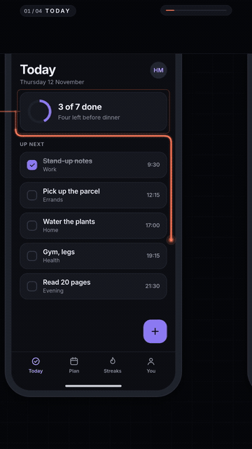

# thread-film

Product films where one drawn line travels through your real screens, the camera follows it, and objects are carried from screen to screen. Built on [Remotion](https://www.remotion.dev).

[](LICENSE) [](https://www.remotion.dev)

## Samples


*One journey, two themes: the same moment in dark (left) and light (right).*

| | |
|---|---|
|  |  |
| The same film in 9:16, with the label placements switched for the narrow frame. | The closing pull-back: the whole line, four screens, one order. |



*A phone app, in 9:16: a task through four screens of a fictional day planner (`mobile-9x16`, see `skill/thread-film/rules/mobile.md`).*

The demo is a 29-second film of one order (Order #1042, $212.54) travelling through four screens of a fictional shop-ops product, Fernwick. Everything in it is data in `src/film/journey.ts` and a theme in `src/film/themes/`.

## Quickstart

```bash
git clone https://github.com/hanzlahabib/thread-film.git thread-film
cd thread-film && pnpm install
pnpm run validate       # checks the journey and both themes' captures
pnpm run render:demo    # out/demo-dark.mp4 and out/demo-light.mp4 (1920x1080, about a minute each)
```

Remotion downloads a headless Chrome the first time it renders. To fetch it ahead of time, or if the download was blocked, run `pnpm exec remotion browser ensure`. To preview and scrub instead of rendering, run `pnpm studio`.

| Script | What it does |
|---|---|
| `pnpm studio` | Remotion Studio with all compositions |
| `pnpm validate` | Checks every film (`src/film/journey.ts`, `src/film/mobile/journey.ts`) and its captures before any render |
| `pnpm render:demo` | Renders `film-16x9` (active theme, dark by default) and `film-16x9-light` to `out/demo-dark.mp4` and `out/demo-light.mp4` |
| `pnpm render:mobile` | Renders `mobile-9x16`, the phone-app demo (also `mobile-9x16-light` and `mobile-16x9` in the studio) |
| `pnpm render:16x9`, `pnpm render:9x16` | Render one composition (active theme) to `out/film-16x9.mp4` or `out/film-9x16.mp4` |
| `pnpm render:screens` | Re-render the demo screens in `demo-screens/` to `public/captures/` and re-measure `demo-screens/anchors.json` |
| `pnpm gif` | Cut `docs/*.gif` from the rendered films with ffmpeg (render `render:demo` and `render:9x16` first) |
| `pnpm audio` | Regenerate the sound effects and music beds in `public/audio/` (they are committed; you only run this to change them) |
| `pnpm typecheck` | TypeScript check |

Compositions: `film-16x9`, `film-9x16` (the active theme) and `film-16x9-light`, `film-9x16-light` (always the light theme).

## Make your own film in two files

1. `src/film/theme.ts`: the look. It exports the active theme, one line (`export const theme = dark;`). The themes themselves are in `src/film/themes/` (`dark.ts`, `light.ts`): colours, fonts, corner radius, line colour, window frame. Copy one and match your product.
2. `src/film/journey.ts`: the film. Your screens in story order, where the line travels across each one, the elements it lands on, the label for each, and the object carried to the next screen.

Put your screenshots (1920 px wide, or a whole multiple such as 2x) in `public/captures/`, then:

```bash
pnpm validate        # checks marks, captures and stops before any render
pnpm studio          # preview film-16x9 and film-9x16
```

The engine in `src/engine/` is not something you edit to make a film. Optional narration clips go in `public/vo/` and are listed in `src/film/vo.json` (empty by default). Sound effects and music come with the engine: see [Sound](#sound).

## How the pattern works

```
 screen A            screen B             screen C
+---------+         +---------+          +---------+
| name  o-+--.      |         |          |         |
| badge   |   '-----+-> row o-+----.     |         |
+---------+         +---------+    '-----+-> total |
   ring+label          carried chip         arrival causes
   on arrival          rides the head       the next thing
```

- **One world.** All screens sit in one large 2D space. There are no cuts in the middle of the film.
- **One line.** A single stroke, one colour, drawn through the screens. The camera follows its head.
- **Arrival causes the next thing.** The line lands beside a real element; only then do a ring and a short label appear. Counters count up when the line reaches them.
- **Carried objects.** At each screen change a chip rides the head of the line and becomes the next thing: a lead becomes a row, a message becomes a conversation, a deal value becomes a number in a report.

Why this beats separate callouts per screen: [skill/thread-film/rules/why-this-works.md](skill/thread-film/rules/why-this-works.md).

Story first: [skill/thread-film/rules/story.md](skill/thread-film/rules/story.md) teaches how to write the hook, the beats and the voiceover before any code, and `pnpm run story-check` flags the common failures.

## Use it with Claude Code

The repo ships a skill that knows the pattern, the two files and the workflow. Install it by symlinking or copying:

```bash
ln -s "$(pwd)/skill/thread-film" ~/.claude/skills/thread-film      # all projects
# or: mkdir -p .claude/skills && cp -r skill/thread-film .claude/skills/   # one project
```

Then ask, for example:

> Use the thread-film skill to make a 60-second launch film for my app from the screenshots in ./shots, using my app's colours.

The skill's theming rules take colours and fonts from your project or your prompt, and its capture rules keep screenshots read-only and free of personal data.

## Sound

Films have sound with no setup. The repo ships synthesised sound effects and three music beds in `public/audio/` (no samples, everything generated by `scripts/make-audio.mjs`, about 2.4 MB in all), and the engine cues them from the schedule:

- a whoosh on every flight (a longer one when the line crosses to another screen), a soft tick on every landing, a pulse when a ring appears, a pop when a label opens, a swap tick when a carried chip lands, a riser into the closing pull-back and a chime on the end card;
- a quiet music bed that fades in, loops if the film is longer than the bed, ducks under narration and under the big effects, and fades out over the end card.

The cue table and timing rules are in [skill/thread-film/rules/sound.md](skill/thread-film/rules/sound.md).

**Mood.** The bed follows the look: set `audio: {mood: 'calm' | 'driven' | 'minimal'}` on the theme (default `calm`).

```ts
// src/film/themes/dark.ts
audio: {mood: 'driven'},
```

**Volume, music and effects.** Everything is optional, in `src/film/journey.ts`:

```ts
audio: {
  music: 'minimal',          // a mood, a file under public/ ('audio/mine.mp3'), or false for no music
  musicVolume: 0.5,          // 0..1, the level while nothing is spoken
  sfx: {volume: 0.5},        // or false for no effects at all
  duck: true,                // lower the music under narration and big effects
}
```

**Bring your own.** `music: 'audio/mine.mp3'` plays your track instead (it loops on its own length, so cut it at a bar line). Replace or mute single effects with `sfx: {overrides: {tick: 'audio/my-tick.wav', ring: false}}`. The older `music: {file, volume}` field still works.

**Regenerate.** `pnpm audio` rewrites `public/audio/` and `src/engine/audio-manifest.json` (Node only; beds are encoded to MP3 with the ffmpeg that ships with Remotion, or one on your PATH, and fall back to large WAVs without one). Edit the notes, tempo or envelopes in `scripts/make-audio.mjs` first if you want different sounds.

The sound has been measured (peak, loudness, silence), not listened to; see the changelog. At the default levels a film without narration is quiet (about -24 LUFS integrated); raise `musicVolume` and `sfx.volume` for a loud feed.

## FAQ

**Which aspect ratios?** Compositions share one journey: `film-16x9` and `film-9x16`, plus `-light` variants of each. In vertical, a label that sits beside an element in landscape can be given its own placement (`portraitLabel`).

**Narration?** Optional. Add one clip per screen to `public/vo/` and list it in `src/film/vo.json`. The film's length follows the clip lengths, and the music ducks under the voice. Narration should not state offers or calls to action, so those stay editable.

**Themes?** Dark and light are both supported and the demo ships both over one journey: a screen lists a capture per mode (`capture: {dark, light}`) and the film picks one from `theme.mode`. The line has one colour for the whole film.

**Do I need real captures?** Yes, that is the point: real screens with demo data, not mockups. Nothing in the engine invents UI. See `skill/thread-film/rules/captures.md`.

**Will it run on a small machine?** Rendering is heavy. The scripts use `--concurrency=2`; keep it low, render one film at a time, and close other heavy programs. Previewing in `pnpm studio` is light by comparison.

## Made with thread-film

- **[LeadLyze](https://leadlyze.com)** - AI lead generation and outreach CRM. The first film in this style was LeadLyze's launch film.

Made a film? Open a pull request adding it here.

## Remotion licence

thread-film is MIT licensed (see [LICENSE](LICENSE)). It depends on Remotion, which is not MIT licensed: companies above Remotion's size threshold need a Remotion company licence. Read the current terms at https://www.remotion.dev/docs/license before using this commercially.

## Contributing

See [CONTRIBUTING.md](CONTRIBUTING.md). Changes are listed in [CHANGELOG.md](CHANGELOG.md).
